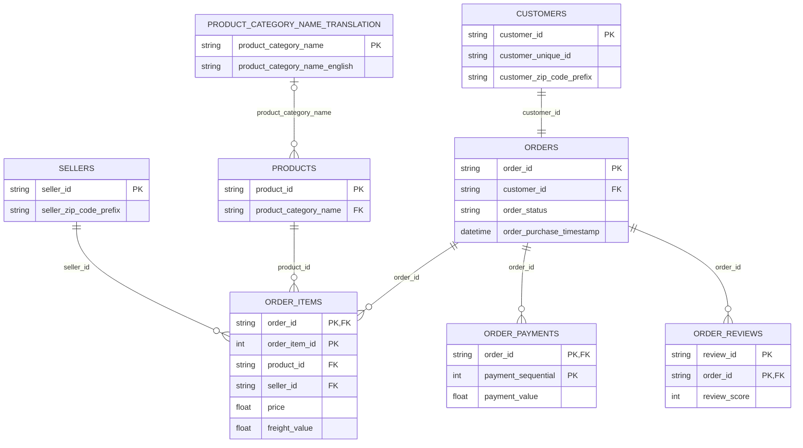

# Modelo relacional — Olist (exploração inicial)

Diagrama conceitual das relações principais identificadas nos CSVs. As cardinalidades indicam os registros observados ou possíveis conforme a granularidade, **não** constraints implementadas em banco.

## Por que geolocalização está fora do diagrama principal?

`geolocation` possui **1.000.163 registros para 19.015 prefixos de CEP**. O campo `geolocation_zip_code_prefix` não é único. Isso significa que um JOIN simples com o CEP de clientes ou vendedores pode multiplicar linhas e distorcer métricas.

Quando houver necessidade de coordenadas, será criada uma tabela/dimensão derivada com **uma linha por prefixo de CEP**, e os registros sem correspondência serão tratados explicitamente. `geolocation` original permanece preservada.

## Observações sobre cardinalidade

- O relacionamento `CUSTOMERS` ↔ `ORDERS` é **1:1 pelos `customer_id` observados**. Compradores reais podem fazer vários pedidos: `customer_unique_id` aparece em vários registros de `customers` (96.096 compradores distintos e 99.441 registros de cliente).
- Em `orders`, existem **775 pedidos sem itens**, **1 sem pagamento** e **768 sem registros de avaliação**. Portanto, a participação dessas tabelas em pedidos é opcional.
- `ORDER_REVIEWS` admite múltiplas avaliações por pedido. O par (`review_id`, `order_id`) é a chave candidata no dataset analisado.
- Em `PRODUCTS`, há **610 categorias nulas** e duas categorias presentes que não têm tradução: a ligação com a tradução é opcional.

## Exemplo do risco de JOIN duplicador

Um pedido com 2 itens e 2 pagamentos gera 4 linhas quando ambas as tabelas são unidas diretamente a `orders` por `order_id`. Somar `payment_value` nesse resultado contaria o pagamento duas vezes. **Primeiro agregue cada tabela na granularidade do pedido** quando o indicador exigir visão por pedido.

Ver também [`dicionario_dados.md`](dicionario_dados.md) e [`qualidade_dados.md`](qualidade_dados.md).
